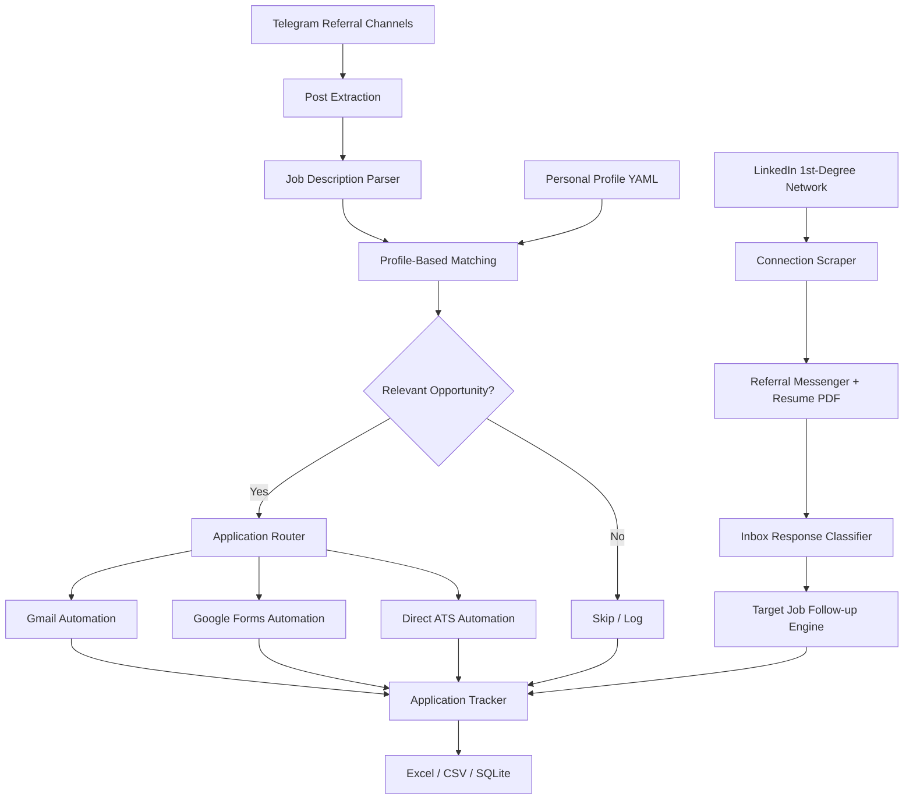

# Apply Bot — Automated Job Application & Referral Assistant

**Telegram Referrals + LinkedIn Networking → Job Matching → Email Applications → Google Forms & Direct ATS**

A locally hosted job application assistant that monitors Telegram referral channels and automates personalized LinkedIn referral outreach, identifies relevant job opportunities based on your profile, and automates repetitive application tasks through Gmail, Google Forms, and direct ATS platforms.

Built for developers and job seekers who want to spend less time on repetitive applications and more time preparing for interviews.

<p align="center">


</p>

---

## Overview

Apply Bot automates the initial stages of a job application and referral workflow.

It monitors Telegram referral channels (default: **SDE Premium Group**), connects with your 1st-degree LinkedIn network for referrals, extracts job postings, evaluates them against your skills and experience, and processes matching opportunities.

### Key capabilities

- **Telegram Monitoring:** Collects job and referral posts from configured Telegram channels looking back up to 14 days.
- **LinkedIn Referral Outreach:** Automatically scrapes 1st-degree connections and sends personalized referral requests with your resume PDF attached directly in LinkedIn messages.
- **Smart Response & Follow-up Classifier:** Scans inbound LinkedIn conversation threads, classifies replies (e.g. asking for resume, asking for job ID / link), and sends context-aware follow-up messages matching target companies (`data/followup_jobs.json`).
- **Profile-Based Matching:** Evaluates opportunities against your skills, experience, preferred roles, and proof points.
- **Automated Email Applications:** Generates and sends application emails to eligible company-domain addresses.
- **Google Forms Automation:** Completes and submits application forms using your configured profile.
- **Direct ATS Application Helpers:** Facilitates quick filling and verification for modern ATS platforms (AshbyHQ, Greenhouse, Lever, Workable).
- **Application Tracking:** Maintains an Excel, CSV, and SQLite record of processed applications.
- **Duplicate Prevention & Safety Throttling:** Built-in rate limits (~30s jitter between messages) and daily caps to keep your LinkedIn and email accounts safe.
- **Dry Run:** Evaluates job postings without sending emails or submitting forms.

---

## Architecture

The system follows a modular pipeline that separates job discovery, eligibility evaluation, networking outreach, application execution, and tracking.



---

## Project Structure

```text
apply-automation/
│
├── config/
│   ├── profile.example.yaml
│   ├── profile.yaml                # Local only (gitignored)
│   ├── settings.yaml
│   └── email_template.example.md
│
├── src/
│   └── apply_bot/
│       ├── apply/                  # Form filling, Gmail drafting, policy
│       ├── boards/                 # Job boards and ATS handlers
│       ├── filter/                 # Relevance and legitimacy filters
│       ├── linkedin/               # Scraper, referral messenger, follow-up
│       ├── parse/                  # Regex and Gemini LLM parsers
│       ├── store/                  # SQLite storage & tracker
│       ├── telegram/               # Telegram channel scraper & extractor
│       ├── cli.py                  # CLI command dispatch
│       └── pipeline.py             # Core pipeline execution
│
├── data/
│   ├── followup_jobs.example.json  # Template for follow-up job definitions
│   ├── job_tracker.xlsx            # Local only (gitignored)
│   ├── applications.db             # Local only (gitignored)
│   ├── chrome-profile/             # Local only (gitignored)
│   └── pw-browsers/                # Local only (gitignored)
│
├── tests/
├── run.ps1                         # PowerShell runner
├── run.bat                         # Windows Batch runner
├── .env.example
├── .gitignore
├── requirements.txt
└── README.md
```

*Runtime data, browser sessions, personal profiles, and application records are stored locally and should not be committed.*

---

## Requirements

Before getting started, ensure you have:

| Requirement | Description |
|---|---|
| Python | 3.11 or newer |
| Telegram | Account with access to the referral channel |
| LinkedIn | Active account with 1st-degree connections |
| Gmail | Signed-in account in the bot's Chromium profile |
| Resume | PDF version of your latest resume (e.g. `data/resume.pdf`) |
| Browser | Chromium installed through Playwright |

---

## Installation

### 1. Clone the repository

```bash
git clone https://github.com/Sumanth3036/apply-automation.git
cd apply-automation
```

### 2. Create a virtual environment

```bash
python3 -m venv .venv
source .venv/bin/activate
```

For Windows PowerShell:

```powershell
python -m venv .venv
.\.venv\Scripts\Activate.ps1
```

### 3. Install dependencies

```bash
pip install -r requirements.txt
```

### 4. Install Playwright Chromium

```bash
PLAYWRIGHT_BROWSERS_PATH="$PWD/data/pw-browsers" playwright install chromium
```

### 5. Configure environment variables & templates

```bash
cp .env.example .env
cp config/profile.example.yaml config/profile.yaml
cp data/followup_jobs.example.json data/followup_jobs.json
```

Edit `config/profile.yaml` with your genuine personal details.

---

## Personal Profile Configuration

Each user maintains an independent profile. No personal information needs to be included in the public repository.

Your profile should contain:

| Field | Purpose |
|---|---|
| Name | Applicant's full name |
| Email | Application email address |
| Phone | Contact number |
| College | Educational institution |
| Batch / Graduation Year | Academic details (e.g. 2026) |
| Available / Notice Period | Notice period (e.g. Immediate, 45 days) |
| Resume Path | Relative or absolute path to resume PDF |
| LinkedIn | Professional profile link |
| GitHub | Project portfolio link |
| Portfolio | Personal website |
| Skills | Technical skills (Python, FastAPI, RAG, PyTorch, etc.) |
| Proof Points | Verified projects and measurable achievements |

**Example proof points:**

```yaml
skills:
  - Python, FastAPI, REST APIs
  - LLM agents, RAG, LangChain, LangGraph
  - PyTorch, Machine Learning, scikit-learn
  - Docker, Redis, RabbitMQ, SQL

proof_points:
  - "Built real-time ML telemetry APIs supporting 50 Hz updates."
  - "Shipped production RAG pipeline with evaluation benchmarks."
  - "Developed multi-agent LLM systems with tool calling and routing."
```

---

## First-Time Authentication

The bot uses a dedicated Chromium browser profile to maintain Telegram, LinkedIn, and Gmail sessions.

Start the authentication process:

```powershell
.\run.ps1 open-channel
```

Or on Linux / macOS:
```bash
PYTHONPATH=src python -m apply_bot open-channel
```

The browser opens Telegram Web:
1. Scan the QR code using your Telegram mobile application.
2. Confirm that the referral channel is accessible.
3. In the same Chromium window, open and sign into **Gmail** and **LinkedIn**.
4. Keep the session active for subsequent runs.

Browser sessions are maintained locally in `data/chrome-profile/` (gitignored).

---

## Command Reference

You can use the provided PowerShell runner `.\run.ps1 <command>` or run via `python -m apply_bot <command>`.

### LinkedIn Automation

| Command | Description |
|---|---|
| `.\run.ps1 linkedin-login` | Opens browser to log into LinkedIn and persist session |
| `.\run.ps1 linkedin-scrape` | Scrapes 1st-degree connections into `data/linkedin_contacts.csv` |
| `.\run.ps1 linkedin-dm` | Sends referral outreach messages with attached resume PDF |
| `.\run.ps1 linkedin-inbox` | Quick scan of inbound replies looking for resume requests |
| `.\run.ps1 linkedin-followup` | Categorizes replies and sends role links/IDs to connections |

### Telegram & Job Application Engine

| Command | Description |
|---|---|
| `.\run.ps1 open-channel` | Opens browser for initial Telegram / Gmail authentication |
| `python -m apply_bot apply-once --limit 80` | Processes up to 80 recent posts and handles eligible applications |
| `python -m apply_bot dry-run --limit 20` | Evaluates job postings without sending emails or submitting forms |
| `python -m apply_bot watch` | Continuously monitors the channel at ~90-second intervals |
| `python -m apply_bot list` | Displays tracked opportunities |
| `python -m apply_bot list --applied` | Displays completed applications |

---

## Privacy and Security

Apply Bot is designed as a local-first application:

- **Zero Credential Leaks:** No personal credentials, session tokens, or personal resumes are tracked in Git.
- **Gitignored Runtime Data:** `data/chrome-profile/`, `.env`, `config/profile.yaml`, `data/*.db`, and all generated spreadsheets/CSVs are strictly ignored in `.gitignore`.
- **Anti-Spam Throttling:** Built-in rate limits (~30s delay) prevent aggressive messaging and protect your social profiles from platform restrictions.
- **Never commit `config/profile.yaml` or `.env`:** Always use the `.example` templates when sharing code or committing changes.

---

## Testing

Run the test suite:

```bash
pytest tests/
```

Some tests require a configured `config/profile.yaml` to load a real user profile.

---

## License

This project is licensed under the MIT License. See [LICENSE](LICENSE) for details.

---

<p align="center">

**Apply Bot**

*Discover opportunities. Match your profile. Automate applications & referrals.*

</p>
